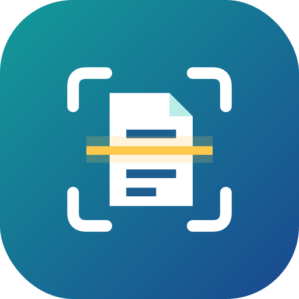

# Scan



An open-source document scanner for Android with the feature set of the big commercial scanner apps. Everything (scanning, OCR, PDF creation) runs **on the phone**. Nothing is uploaded, and you don't need an account.

Built and tuned for the Galaxy S21 FE (Android 12+, Material You colours), it works on any Android 10+ phone with Google Play Services.

## Features

| | |
|---|---|
| **Capture** | Live edge detection, auto-capture, auto perspective-crop, stain & finger removal, multi-page (up to 100), import from gallery |
| **Import** | Import existing PDFs; "Share to Folio Scan" from Gallery/Files/WhatsApp (images or PDF) |
| **Edit pages** | Re-crop with 4 free corners (perspective), rotate, filters (Auto colour, Grayscale, B&W document, Whiteboard, Lighten), undo all edits, reorder, delete, add more pages |
| **OCR** | On-device text recognition (Latin or Devanagari + English), offline; copy/share text |
| **Searchable PDF** | Every PDF gets an invisible text layer → selectable & searchable in any PDF reader |
| **Search** | Find scans by name *or by any word inside them* |
| **Fill & sign** | Draw and save a signature, place it on any page; add typed text (name, date) in black/blue ink |
| **Export** | PDF or JPEG; High/Medium/Small compression; password-protected PDF; share to any app; save to Downloads/FolioScan or Pictures/FolioScan; print |
| **Organise** | Rename, delete, multi-select, merge documents |

## Getting the APK (no Android Studio needed)

1. Create an empty repository on GitHub and push this folder to it (`main` branch).
2. GitHub Actions builds it automatically (about 5–8 minutes).
3. On your phone open the repo's **Releases → Latest build** and download `Scan.apk`.
4. Open it and allow "Install unknown apps" for your browser when asked.

Every new push rebuilds and replaces the APK. All builds are signed with the same key (`keystore/`), so updates install over the old version without losing your scans.

> The bundled key is fine for personal sideloading. Before publishing to F-Droid or Play, replace it with a private key stored in GitHub Secrets.

## Building locally (Linux)

Requires JDK 17 and the Android SDK (Android Studio installs both). Then run:

```bash
gradle assembleRelease      # or open the folder in Android Studio and press Run
```

## Tech

Kotlin · Jetpack Compose (Material 3) · Google ML Kit Document Scanner + Text Recognition (on-device) · PdfBox-Android · Coil. Documents are stored privately in app storage as JPEG pages + a JSON index.

## Licence

Apache-2.0. Note that ML Kit itself is a free but closed-source Google library, while the app code is fully open.
